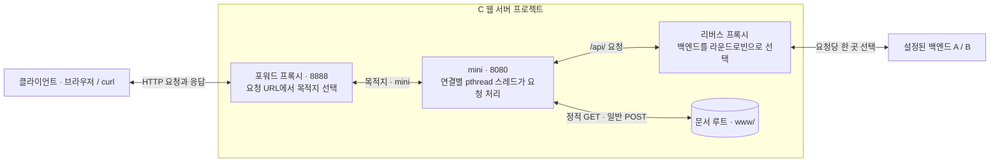

# C 웹 서버와 HTTP 프록시

> **구현 원칙**
>
> 구현복잡도=내가 이해하는 수준
> 코드를 이해도를 최선으로 하여 기술 부채를 줄입니다. 아무리 좋은 기능이라도 동작 원리를 제가 설명할 수 있을 때 코드에 넣습니다.그렇지 않으면 넣지 않는다.
>
> 이 원칙을 지키기 위해 목요일 오전 1시까지 최대한 직접 코드를 작성했습니다. 그 이후에는 부족한 세부 구현을 바이브 코딩으로 보완했습니다.
> CSAPP 책에 나온 코드를 바탕으로 하여 작성하였습니다. 부족한 부분은 검색을 채웠습니다.

## STACKDIAG 아키텍처 지도

두 프록시를 차례로 거치는 구성입니다. 클라이언트는 포워드 프록시에 접속하고, 목적지 URL로 `mini`의 `/api/` 경로를 지정합니다.



두 프록시를 함께 확인하려면 각 서버를 실행한 뒤 다음 요청을 보냅니다.

```sh
curl -i --noproxy "" --proxy http://127.0.0.1:8888 http://127.0.0.1:8080/api/demo.txt
```

현재 실행 구성에서 `mini`는 포트 `8080`으로 직접 들어오는 연결도 받습니다. 위 그림은 프록시를 두 단계로 거치는 요청 경로를 보여줍니다.

## 프로젝트 소개

C로 구현한 HTTP 웹 서버입니다. `mini`는 문서 루트의 파일을 제공하고 POST 본문을 저장하며, 지정된 경로의 요청을 백엔드에 중계합니다. 별도 실행 파일인 `forward_proxy`는 클라이언트가 지정한 HTTP 목적지에 연결합니다.

| 핵심 개념 | 이번 구현에서의 의미 |
| --- | --- |
| HTTP 요청의 경계 | 요청 줄과 헤더를 분리하고, `Content-Length`만큼 본문을 받습니다. |
| 연결 단위 동시성 | `mini`는 받아들인 연결마다 스레드를 만들어 여러 클라이언트를 처리합니다. |
| 프록시의 목적지 선택 | 리버스 프록시는 서버의 경로 설정을, 포워드 프록시는 클라이언트가 보낸 URL을 사용합니다. |

## 개발 환경

| 항목 | 사용 환경 |
| --- | --- |
| 운영체제 | macOS (Apple Silicon) |
| 컴파일러 | Apple Clang 17.0.0 (Makefile의 `gcc` 명령으로 실행) |
| 빌드 도구 | GNU Make |
| 테스트 도구 | `curl`, Python 3 표준 라이브러리, ApacheBench (`ab`) |

## 기술 스택

| 기술 | 사용처 |
| --- | --- |
| C, POSIX 소켓 API | TCP 연결 수락·생성 및 데이터 송수신 |
| HTTP/1.0·HTTP/1.1 요청 | 메서드와 요청 경로, 헤더 파싱. 지원 메서드는 GET과 POST |
| POSIX Threads (`pthread`) | `mini`에서 연결마다 스레드 하나로 요청 처리 |
| POSIX 파일·프로세스 API | 정적 파일 읽기, POST 본문 저장, `fork()`·`execve()` 기반 CGI |

서버와 프록시의 HTTP 처리는 C 코드에서 직접 구현했습니다.

## 주요 기능

| 기능 | 직접 구현한 내용 | 선택 이유 |
| --- | --- | --- |
| TCP 연결과 HTTP 파싱 | `socket()`·`bind()`·`listen()`·`accept()`로 연결을 받습니다. 요청 줄과 `Host`, `Content-Length`, `Connection`을 확인합니다. | 연결 처리와 HTTP 메시지 파싱을 분리하고, 본문 길이를 확인할 수 있습니다. |
| 정적 GET과 오류 응답 | 문서 루트 아래의 파일을 열어 실제 크기와 MIME 타입을 응답에 넣습니다. 파일이 없으면  `404` 페이지를 보냅니다. | 브라우저가 응답 상태와 파일 형식을 알 수 있습니다. |
| POST 파일 저장 | 요청 본문을 문서 루트의 새 파일에 저장합니다. 저장에 성공하면 `201`, 같은 파일명이 있으면 `409`를 반환합니다. | GET으로 저장 결과를 다시 읽을 수 있고 기존 파일을 보호합니다. |
| 동시 요청과 종료 | `mini`는 연결마다 `pthread`를 생성하고 종료 신호를 받으면 연결과 스레드를 정리합니다. | 느린 연결이 다른 요청의 처리를 지연시키는 상황을 줄입니다. |
| 리버스 프록시 | 경로 접두사로 프록시 요청을 구분하고, 여러 백엔드를 라운드로빈으로 선택합니다. | 클라이언트가 내부 백엔드 주소를 알 필요 없이 하나의 주소로 요청할 수 있습니다. |
| 포워드 프록시 | HTTP URL을 호스트·포트·경로로 나눠 목적지에 연결하고 응답을 중계합니다. | 클라이언트가 요청마다 목적지를 지정할 수 있습니다. |

## 핵심 설계와 고려한 점

### 연결마다 스레드를 만드는 이유

주 스레드는 새 TCP 연결을 받고, 작업 스레드는 해당 연결에서 요청을 읽고 처리합니다. 한 클라이언트가 헤더의 나머지를 보내지 않아도 다른 스레드는 정적 파일을 응답할 수 있습니다. 작업 목록과 백엔드 선택 순번은 뮤텍스로 보호합니다. 구현 흐름은 단순하지만, 동시 연결 수가 늘면 스레드 생성과 메모리 사용 비용도 늘어납니다.

### 파일 경로와 POST 저장

요청 경로를 문서 루트 기준으로 해석하고, 상위 폴더를 `realpath()`로 확인한 다음 `open()`을 사용합니다. POST는 새 파일만 열고, 본문이 중간에 끊기거나 쓰기에 실패하면 생성하던 파일을 정리합니다. 경로 검사와 파일 열기 사이에 문서 루트의 폴더 구조를 신뢰할 수 없는 사용자가 변경할 수 없는 환경을 전제로 합니다.

### 두 프록시의 요청·응답 중계

리버스 프록시는 설정된 경로에 연결된 백엔드를 순서대로 선택합니다. 포워드 프록시는 절대 URL에서 접속할 서버를 찾고, 원 서버에 전달할 요청 줄을 경로 형태로 구성합니다. 두 방식 모두 같은 TCP 연결 함수를 사용합니다. 리버스 프록시에서 백엔드가 응답을 시작하기 전에 수신 시간이 초과되면 `504 Gateway Timeout`을 반환합니다.

## 빌드

C 컴파일러와 `make`가 필요합니다. 프로젝트 루트에서 실행합니다.

```sh
make
```

아래 요청 예제에는 `curl`을 사용합니다. 예제 백엔드와 통합 테스트를 실행하려면 `python3`가 필요합니다.

## 실행

### 테스트용 백엔드

백엔드가 준비돼 있으면 이 단계는 생략할 수 있습니다. 별도 터미널에서 임시 디렉터리를 만들고 HTTP 서버를 실행합니다.

```sh
backend_dir=$(mktemp -d)
mkdir -p "$backend_dir/api"
printf 'Hello from backend\n' > "$backend_dir/api/demo.txt"
python3 -m http.server 8001 --bind 127.0.0.1 --directory "$backend_dir"
```

### 웹 서버와 리버스 프록시

프로젝트 루트에서 포트, 문서 루트, 백엔드 호스트와 포트를 순서대로 지정합니다.

```sh
./mini 8080 ./www 127.0.0.1 8001
```

| 요청 | 예상 결과 |
| --- | --- |
| `GET /index.html` | `200 OK`와 정적 HTML |
| `GET /missing.html` | 키키 뮤직비디오를 포함한 `404 Not Found` 페이지 |
| `GET /api/demo.txt` | 포트 `8001` 백엔드의 응답 |
| `POST /<새 파일명>` | 문서 루트에 요청 본문을 저장하고 `201 Created` 반환 |

```sh
curl -i http://127.0.0.1:8080/index.html
curl -i http://127.0.0.1:8080/api/demo.txt

file="upload-$(date +%s).txt"
curl -i --data 'Hello from POST' "http://127.0.0.1:8080/$file"
curl -i "http://127.0.0.1:8080/$file"
```

같은 파일에 다시 POST하면 기존 파일을 유지하고 `409 Conflict`를 반환합니다.

라우팅 경로를 바꾸려면 문서 루트 뒤에 `--route=/경로/`를 넣습니다. 백엔드를 여러 개 쓸 때는 실행 중인 서버의 호스트·포트 쌍을 이어서 지정합니다.

```sh
./mini 8080 ./www --route=/api/ 127.0.0.1 8001 127.0.0.1 8002
```

### 포워드 프록시

```sh
./forward_proxy 8888
```

다른 터미널에서 프록시 주소와 요청할 목적지 URL을 지정합니다.

```sh
curl -i --noproxy "" --proxy http://127.0.0.1:8888 http://127.0.0.1:8001/api/demo.txt
```

서버를 종료하려면 실행 중인 터미널에서 `Ctrl+C`를 누릅니다.

## 검증 결과

```sh
make test
```

macOS에서 로컬 백엔드와 실제 C 서버를 실행해 **통합 테스트 확인 항목 21개**를 통과했습니다. 라운드로빈은 요청 네 번의 응답 순서를 각각 확인합니다.

| 검증 대상 | 확인한 내용 | 확인 항목 |
| --- | --- | ---: |
| 정적 응답 | HTML 파일과 404 본문, CSS·JS·JPEG의 MIME 타입 | 5 |
| 잘못된 요청과 경로 | 문서 루트 밖 경로, 심볼릭 링크, HTTP 버전 누락, 지원 범위 밖 본문 전송 방식, 중복 `Content-Length` | 5 |
| 일반 POST | 분할 전송에 대한 `201`, 본문 저장, 기존 파일 보존과 `409` | 3 |
| 동시성과 종료 | 첫 연결이 헤더를 기다리는 동안 다른 요청에 응답, 작업 중 `SIGTERM` 종료 | 2 |
| 프록시 | 라운드로빈 4회, 리버스 프록시 POST, 포워드 프록시 GET | 6 |

### 로컬 정적 파일 처리량

ApacheBench로 27바이트짜리 `/index.html`에 회당 1,000건을 요청했습니다. 2026년 11월 26일 Apple Silicon macOS의 루프백 주소에서 동시성 수준별로 세 번씩 실행했습니다.

| 동시 요청 수 | 초당 요청 수 중앙값 | 회당 실패 |
| ---: | ---: | ---: |
| 1 | 11,025.48 | 0 / 1,000 |
| 10 | 33,248.00 | 0 / 1,000 |

이 수치는 같은 컴퓨터에서 정적 파일을 읽는 실험의 결과입니다. 네트워크를 거치는 요청이나 백엔드 처리 시간은 측정 범위 밖입니다.

```sh
ab -n 1000 -c 1 http://127.0.0.1:8080/index.html
ab -n 1000 -c 10 http://127.0.0.1:8080/index.html
```

## 프로젝트 구조

| 경로 | 역할 |
| --- | --- |
| [sys/mini.c](sys/mini.c) | HTTP 서버, 요청 파싱, 파일 응답·저장, 연결별 스레드 |
| [sys/server.c](sys/server.c), [sys/client.c](sys/client.c) | 수신 소켓 생성, 목적지 TCP 연결 |
| [proxy/reverse_proxy.c](proxy/reverse_proxy.c) | 백엔드 요청 전달 및 응답 중계 |
| [proxy/forward_proxy.c](proxy/forward_proxy.c) | 포워드 프록시 실행 파일의 소스 |
| [www/](www/) | 예제 정적 파일 |
| [tests/integration.py](tests/integration.py) | 통합 테스트 |

## 지원 범위

요청 본문은 `Content-Length`로 처리합니다. `mini`의 요청 본문 상한은 1 MiB입니다. 포워드 프록시는 일반 HTTP를 지원하고 HTTPS의 `CONNECT` 터널은 지원하지 않습니다. 리버스 프록시는 백엔드에 `Connection: close`를 요청하고, 백엔드 연결이 닫히거나 수신 시간이 초과될 때까지 응답을 중계합니다.
