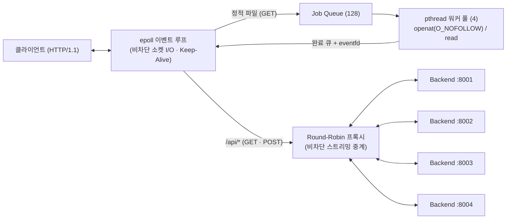

# C11 동시성 HTTP/1.1 웹 서버 · 리버스 프록시

외부 HTTP 라이브러리 없이 **C11 + POSIX 소켓 + Linux `epoll` + `pthread`**만으로 구현한 동시성 HTTP/1.1 웹 서버 및 리버스 프록시입니다.

정적 파일 서빙, 바이너리 POST 본문 수신, HTTP/1.1 Keep-Alive 연결 재사용, 4대 백엔드 Round-Robin 스트리밍 리버스 프록시를 지원하며, 5대 품질 영역(단위 · 기능 · 부하 · 메모리/경합 · 엣지/보안/퍼징) 검증과 브라우저 실시간 대시보드를 함께 제공합니다.

---

## 아키텍처



- **단일 이벤트 루프 소켓 소유권**: 모든 클라이언트·백엔드 TCP 소켓 I/O는 논블로킹 `epoll` 이벤트 루프가 전담해 소켓 단위 락 경합을 제거합니다.
- **디스크 I/O 분리**: 블로킹이 발생할 수 있는 정적 파일 탐색·읽기만 `pthread` 워커 스레드 풀(4 workers, 대기열 상한 `128`)로 분리하고 완료 시 `eventfd`로 이벤트 루프를 깨웁니다.
- **프록시 비차단 스트리밍**: `/api` 요청은 백엔드 소켓도 같은 `epoll`에 등록해 워커를 점유하지 않고 조각 단위로 즉시 스트리밍 중계합니다.
- **메모리·FD 안전성**: `slots[]` + `generations[]` 세대 번호 결합 키로 슬롯/FD 재사용 시 지연 이벤트와 UAF를 차단하며, 워커 `RUNNING` 중 클라이언트 급단절 시 `closed = 1`로 해제를 지연해 완료 시점에 안전하게 회수합니다.

---

## 프로젝트 구조

| 경로 | 역할 |
| --- | --- |
| `server.c` | `main()`, 13개 필수 인자·`RLIMIT_NOFILE` 사전 검증, `listen(..., SOMAXCONN)` 리스너 생성 |
| `concurrency.c/.h` | `epoll` 이벤트 루프, 4-워커 `pthread` 풀, Keep-Alive 상태 전이, 세대 번호, 10초 타임아웃 |
| `http_request.c/.h` | TCP 조각 분할 누적 파서(`http_request_feed_bytes`), 엄격 CRLF·NUL·`Host`·8,192B 상한·HTTP/1.1 검증 |
| `http_body.c/.h` | `Content-Length`·`Transfer-Encoding`·`Expect` 검증, `memcpy` 기반 바이너리 본문 수신 |
| `http_response.c/.h` | 상태 라인·응답 헤더 생성, 부분 송신(`EAGAIN`) 및 `EINTR` 처리 |
| `static_files.c/.h` | 1회 퍼센트 디코딩, `openat(..., O_NOFOLLOW)` + `st_dev`/`st_ino` 경로 탈출 차단, MIME 매핑 |
| `proxy.c`, `proxy_config.c`, `proxy.h` | 시작 시 DNS 해석, `/api` 라우팅, Round-Robin, `chunked`/EOF 스트리밍, `Location` 재작성 |
| `request_io.c/.h` | 초기 순차 수신 API 및 회귀 검증 호환 레이어 |
| `public/dashboard.html` | 5대 품질 영역 실시간 브라우저 검증 대시보드 (22종 라이브 체크 · 4대 백엔드 분산 · 간트 차트 · 라이브 부하) |
| `demo/` | 4대 데모 백엔드(`demo_backend.py`), 데모 실행(`run_demo.sh`), 외부 표준 도구 스위트(`run_ext_suite.sh`) |
| `tests/` | C 단위 테스트 6종, Raw TCP/통합 Python 테스트, `tests/fuzz/` `libFuzzer` 하네스 3종 |
| `validation/` | 부하·회귀·안전성(ASan/UBSan/TSan)·600초 Soak 자동화 하네스 및 리포트 생성기 |
| `docs/` | 단계별 요구사항 및 설계 명세 문서 |

---

## 주요 기능

- **HTTP/1.1 엄격 파싱**: 조각 분할 수신, CRLF 강제, NUL 차단(`400`), `Host` 필수·중복 검사(`400`), 헤더 `8,192B` 상한(`431`), `HTTP/1.1` 전용(`505`), 미지원 메서드(`501`).
- **안전한 정적 파일 서빙**: `static_root_open()` 루트 FD 고정, `fstatat` + `openat(O_NOFOLLOW)` + `st_dev`/`st_ino` 대조로 `../`·`%2e%2e`·심볼릭 링크 탈출 차단(`403`), 디렉터리 `/docs` → `301 /docs/` 정규화, 없는 파일 `404`, 확장자별 MIME 매핑.
- **POST 본문 & Keep-Alive**: `CL` 중복 및 `CL+TE` 충돌 차단(`400`), `BODY_LIMIT` 초과(`413`), `Expect: 100-continue` 임시 응답 / 미지원 값(`417`), 바이너리(`0x00` 포함) 무손실 처리, 비-API POST `204 No Content`, `pending[4096]` 파이프라이닝 잔여 바이트 보존 및 `reset_request()` 기반 연결 재사용.
- **리버스 프록시**: `/api` 및 `/api/*`를 다중 백엔드로 Round-Robin 분산, `Host` 재작성 및 `Via: 1.1 ljm-proxy` 부여, `Transfer-Encoding: chunked` 및 `EOF` 응답을 유한 버퍼 스트리밍 중계, 내부 `Location`을 `PUBLIC_URL`로 변환, 정상 백엔드 `500` 원문 보존 vs 깨진 응답 `502` vs 타임아웃 `504`.
- **시간 제한 & 우아한 종료**: 요청 수신 10초(`408`), 송신 무진행 10초, 작업 대기 10초, 본문 총수신·Keep-Alive idle·프록시 접속/응답 기한 개별 관리, `SIGINT`/`SIGTERM` 수신 시 새 수락 중단 후 최대 10초 내 진행 중 요청 마무리.

---

## 실행 방법

### 1. Docker로 빠르게 실행

```sh
docker build -t week13-web-server .
docker run --rm --name week13-web-server -p 127.0.0.1:8080:8080 week13-web-server
```

- 기본 페이지 확인: `http://localhost:8080/`
- 종료: `docker stop --timeout 15 week13-web-server`

### 2. 4대 백엔드 데모 + 실시간 5대 품질 검증 대시보드 실행

```sh
docker run -d --rm --name week13-web-server-demo \
  -e PUBLIC_URL=http://localhost:8081 \
  -p 127.0.0.1:8081:8080 \
  -v "$PWD/public:/app/public:ro" \
  -v "$PWD/demo:/app/demo:ro" \
  -w /app week13-web-server \
  sh -c "tr -d '\r' < /app/demo/run_demo.sh > /tmp/run_demo.sh && chmod +x /tmp/run_demo.sh && exec /tmp/run_demo.sh"
```

브라우저에서 `http://localhost:8081/dashboard.html`을 열고 **`▶ 전체 실시간 검증 (22종)`**을 실행하면 4대 백엔드 Round-Robin 분산, 비차단 동시성 간트 차트, 엣지 케이스(`403`/`413`/`431`/`501`/`502`/`504`/급단절), 라이브 미니 부하 테스트를 바로 확인할 수 있습니다.

### 3. Linux에서 직접 빌드 및 실행

```sh
make
sh ./start.sh
```

직접 실행 시 아래 **13개 필수 인자**를 모두 지정해야 합니다.

```sh
./server <port> <root> <workers> <queue_limit> <connection_limit> \
  <body_limit> <body_timeout> <keep_alive_timeout> <keep_alive_max_requests> \
  <public_url> <proxy_connect_timeout> <proxy_response_timeout> <backends>
```

실행 예시 (`start.sh` 기준):

```sh
./server 8080 ./public 4 128 100 1048576 30 10 100 \
  http://localhost:8080 5 10 http://127.0.0.1:8001,http://127.0.0.1:8002
```

---

## 5대 품질 영역 검증 결과

### 1. 단위 테스트 (`make test sanitize`)

일반 빌드(`-Wall -Wextra -Wpedantic`)와 **ASan + UBSan + LSan (`detect_leaks=1`)** 빌드에서 6개 모듈 전체 **100% PASS**했습니다.

```sh
docker run --rm week13-web-server make test sanitize
```

| 모듈 | 주요 검증 항목 | 결과 |
| --- | --- | --- |
| `tests/test_http_request.c` | 조각 분할 수신, CRLF, NUL, `Host`(IPv4/IPv6), 8,192B 상한, `realloc` 실패 주입 | **97 / 97 PASS** |
| `tests/test_static_files.c` | 확장자별 MIME, 1회 퍼센트 디코딩, `O_NOFOLLOW` 경로 탈출, `301`/`403`/`404`, FD 회수 | **2,400 PASS** |
| `tests/test_proxy.c` | 모든 분할 위치 `chunked`/헤더 파싱, 배압 타이머 보존, `Location` 경계 변환 | **PASS** |
| `tests/test_http_body.c` | CL/TE/Expect 검증, 오버플로 차단, 바이너리 경계 분할, `malloc` 실패 500 주입 | **PASS** |
| `tests/test_http_response.c` | 응답 포맷, 부분 `send()`, `EINTR` 재시도, 파일 읽기 실패·조기 EOF | **PASS** |
| `tests/test_concurrency_state.c` | 작업 큐 포화·공정 재시도, 10초 기한, 부분 `100 Continue` 뒤 최종 오류 순서 보존 | **PASS** |

### 2. 기능 테스트 (브라우저 실시간 14종 + 4대 백엔드)

- **정적 파일 · MIME**: HTML(`text/html`), CSS(`text/css`), TXT(`text/plain`), `/docs` → `301 /docs/`, 없는 파일 `404` 확인.
- **POST & Keep-Alive**: 비-API POST `204`, 0B 빈 본문, `0x00~0xFF` 포함 `2,048B` 바이너리 본문 백엔드 에코 100% 일치, Keep-Alive 12회 연속 혼합 요청 유지 확인.
- **4대 백엔드 프록시**: `backend-1`~`4` 20회 요청 **5 : 5 : 5 : 5** 균등 분산, `Host` 재작성 + `Via: 1.1 ljm-proxy`, `chunked` 5조각 스트리밍, `Location` 공개 주소 변환, 백엔드 `500` 원문 보존 확인.
- **비차단 동시성**: 1.4초 지연 요청 1개와 빠른 요청 6개 동시 발사 → 빠른 요청 6개 모두 느린 요청 완료 전에 응답.

### 3. 엣지 케이스 · 보안 · DoS 방어 · 퍼징

- **브라우저 실시간 8종**: `PUT`/`DELETE` `501`, 본문 상한 초과 `413`, `8,300B` 긴 URI `431`, 심볼릭 링크 `403`, 깨진 백엔드 응답 `502`, 백엔드 무응답 `504` (`3.004s`), `AbortController` 150ms 급단절 후 즉시 `200` 복구.
- **Raw TCP 78종 (`78 / 78 PASS`)**: 불완전 헤더·NUL·CR 누락 `400`, HTTP/1.0·2.0 `505`, CL 중복/충돌 `400`, chunked 요청 `501`, `Expect` `417`, `/../` `403`, 격리 Docker `iptables` SYN DROP (`5.001s` 후 `504` → 해제 후 `200`), 워커 실행 중 급단절 + FD 재사용 UAF 방어.
- **Slowloris DoS 방어 (`slowhttptest -c 120 -H -i 2 -r 60 -l 16`)**:
  - 120개 공격 연결 동안 `service available: YES`, 정상 `curl` **20 / 20 HTTP 200 (실패 0건)**.
  - 12초 시점 120개 공격 연결 전원 `408` 자동 차단, 열린 FD **`7 → 125 → 7`** 완전 복구.
- **`libFuzzer` + ASan/UBSan/LSan 무작위 퍼징 (총 2,386,719회 · 크래시/UB/누수 0건)**:
  - `tests/fuzz/fuzz_http_request.c`: **916,676회** (`43,651 exec/s`, 코퍼스 1,962)
  - `tests/fuzz/fuzz_static_files.c`: **1,020,674회** (`48,603 exec/s`, 코퍼스 479)
  - `tests/fuzz/fuzz_proxy_wire.c`: **449,369회** (`21,398 exec/s`, 코퍼스 1,797)

### 4. 부하 테스트 및 병목 개선

초기 부하 검증에서 확인한 두 가지 병목(`QUEUE_LIMIT 64 → 128`, `listen` 백로그 `SOMAXCONN` 상향)을 수정해 오류 0건을 달성했습니다.

| 개선 항목 / 시나리오 | 개선 전 (Before) | 개선 후 (After) |
| --- | --- | --- |
| `QUEUE_LIMIT 64 → 128` (`static c=100`) | `503` 12,772건 | **349.7 RPS · 오류 0** |
| `QUEUE_LIMIT 64 → 128` (`mixed c=100`) | `503` 3,237건 | **601.4 RPS · 오류 0** |
| `listen(SOMAXCONN)` (`proxy c=200`) | deadline 83건 | **1,498.8 RPS · 오류 0** |
| `listen(SOMAXCONN)` (`mixed c=200`) | 접속 기한 초과 | **1,031.2 RPS · 오류 0** |

네이티브 부하 도구 **`wrk`** (HTTP/1.1 Keep-Alive, 4 threads, 10s, 4대 백엔드) 및 **`ab`** 측정 결과:

| 도구 / 시나리오 | 동시성 | 처리량 (RPS) | p50 / p99 지연 | 오류 |
| --- | --- | --- | --- | --- |
| `wrk` Static 4KB | `c=50` | **1,083.49 RPS** | `43.96ms` / `48.28ms` | **0** |
| `wrk` Static 4KB | `c=100` | **2,248.14 RPS** | `43.94ms` / `48.46ms` | **0** |
| `wrk` Proxy 4-Backends | `c=50` | **969.22 RPS** | `44.19ms` / `164.79ms` | **0** |
| `wrk` Proxy 4-Backends | `c=100` | **892.09 RPS** | `98.12ms` / `439.49ms` | **0** |
| `ab` HTTP/1.0 거절 부하 | `n=20,000, c=100` | **2,851.92 RPS** | `24ms` / `236ms` | **0** (전원 `505` 엄격 거절) |

부하 테스트 직후 서버 프로세스 자원: **FD `7` · `VmRSS 3,012 KiB` · Threads `5`**.

### 5. 메모리 누수 · 스레드 경합 · 장기 안정성

- **ASan + UBSan + LSan (`detect_leaks=1`)**: 단위 6모듈 + 통합 서버 + `libFuzzer` 238만 회 모두 **누수 0 · UAF 0 · UB 0**.
- **Valgrind Memcheck (실서버 바이너리 17종 전 경로 + `SIGTERM` 종료)**: `in use at exit: 0 bytes in 0 blocks`, `81 allocs, 81 frees (1,735,515 bytes)`, **`ERROR SUMMARY: 0 errors`**.
- **ThreadSanitizer (`setarch -R`)**: Docker 내 ASLR 해제 후 멀티스레드 Keep-Alive 검증 통과 (`2.888s`, **0 data races**).
- **600초(10분) 지속 부하 (`soak-mixed-c050`, 132,314건)**: 오류 **0건**, **RSS `6,864 KiB → 6,864 KiB` 고정**, **FD `7 → 7`**, **스레드 `5 → 5`**.

---

## 설계 · 검증 문서

- [프로젝트 요구사항](docs/project-spec.md) · [전체 설계](docs/design-spec.md)
- [HTTP 파서 요구사항](docs/http-parser-requirements.md) · [파서 설계](docs/http-parser-design.md)
- [오류 응답 요구사항](docs/error-response-requirements.md) · [오류 응답 설계](docs/error-response-design.md)
- [정적 파일 요구사항](docs/static-files-requirements.md) · [정적 파일 설계](docs/static-files-design.md)
- [동시성 요구사항](docs/concurrency-requirements.md) · [동시성 설계](docs/concurrency-design.md)
- [POST 본문 요구사항](docs/post-body-requirements.md) · [POST 설계](docs/post-body-design.md)
- [Keep-Alive 요구사항](docs/keep-alive-requirements.md) · [Keep-Alive 설계](docs/keep-alive-design.md)
- [리버스 프록시 요구사항](docs/reverse-proxy-requirements.md) · [프록시 설계](docs/reverse-proxy-design.md)
- [검증 하네스 가이드](validation/README.md) · [초기 부하 실측 보고서](validation-results/20261125T110525Z/REPORT.md)
